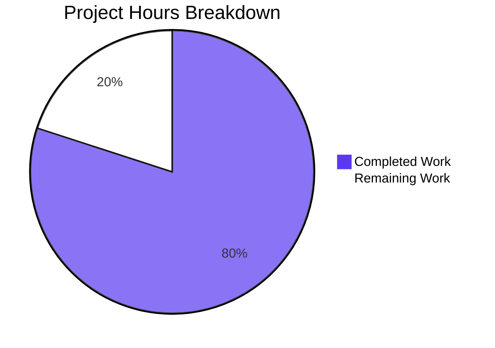
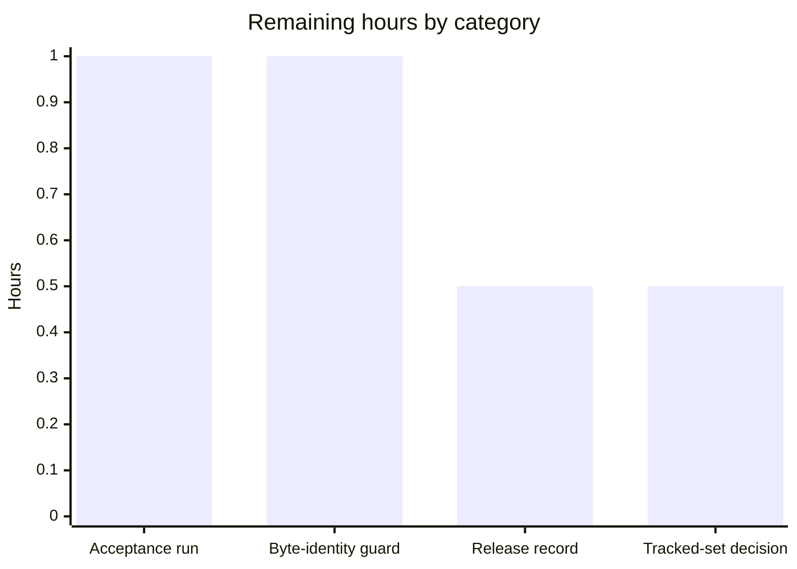

# 1. Executive Summary

## 1.1 Project Overview

Two files deliver a byte-exact greeting. `hello.sh` prints `Welcome to Blitzy` to standard output as exactly 18 unformatted bytes; `hello_world.txt` holds that line 99,900 times as committed content — 1,798,200 bytes, LF-terminated, pinned by SHA-256 digest. There is no interface beyond standard output, no dependency, no build step and no service. The audience is anyone needing a deterministic greeting program and a byte-stable 99,900-line file for exercising line-count, checksum and diff tooling.

## 1.2 Completion Status



Completion: **80.0%** — 12.0 completed hours of 15.0 total (12.0 ÷ 15.0).

| Metric | Hours |
|---|---|
| Total Hours | 15.0 |
| Completed Hours (AI + Manual) | 12.0 |
| Remaining Hours | 3.0 |

## 1.3 Key Accomplishments

- One-line program: exactly 18 bytes, byte-identical to a reference stream, empty stderr, exit 0.
- Form held: one line, 23 bytes, no shebang, mode 644, no comments, logging or argument handling.
- Content file: 99,900 lines, 1,798,200 bytes, byte-identical to a separately built reference file.
- SHA-256 pinned and reproduced from the worktree file and the committed blob.
- Invocation proven without arguments, environment, `PATH`, working directory or stdin.
- Determinism across 50 sequential and 100 concurrent runs, and every shell present.
- Repository integrity: not ignored, no attribute filter, committed blob of 1,798,200 real bytes.
- No generator in the tree or its history; the greeting appears only where it should.

## 1.4 Critical Unresolved Issues

All 29 recorded requirements are delivered and verified. Seven of the 29 carry an open caveat or a release-time decision; the other 22 carry none.

| Issue | Impact | Owner | ETA |
|---|---|---|---|
| Repository is pre-wired for Git LFS (`filter.lfs` with `required = true`, four git-lfs hooks); byte identity rests on no attribute rule existing | A future `*.txt filter=lfs` line could commit a ~130-byte pointer while the working tree still looked correct | Repository owner | Before first release (~1 h) |
| Tracked set is three paths, not two, because the pre-existing `README.md` is tracked | A check expecting exactly two paths reports a false failure | Repository owner | Release checklist (~0.5 h) |
| Recorded host and tool inventory (dash build, distribution release, coreutils, grep, Git, git-lfs presence) does not describe the delivery host | The instruments behind the acceptance evidence would be described wrongly; no measured value is affected | Release owner | Release record (~0.5 h) |
| Delivery commit message quotes the greeting literal once | None — immutable delivery metadata that no consumer reads | Repository owner | No action required |
| busybox `ash` byte-identity and syscall-level proof that the program opens no file were never exercised | Two portability and tracing legs remain unverified (neither tool is installed) | QA | Optional |
| `bash hello.sh` with an exported function named `echo` prints the injected text | Affects only a non-pinned interpreter in a hostile environment; `sh hello.sh` is unaffected | Operator | Documented in the release record |
| Below `ulimit -n` 16 the interpreter cannot read any script file and exits before the program runs | Startup failure under a starved descriptor table, unreachable at the host default of 65536 | Operator | Documented in the release record |

## 1.5 Access Issues

No access issues identified. The deliverable authenticates to nothing: no credential, network connection, service, registry or secret is needed to build, run or verify it.

## 1.6 Recommended Next Steps

1. **[High]** Run the full acceptance catalogue on a clean checkout and confirm the digest, the 99,900-line count and the 1,798,200-byte committed blob.
2. **[High]** Add the byte-identity guard rows to the release check (`git check-attr -a -- hello_world.txt` empty; `git cat-file -s HEAD:hello_world.txt` = 1798200) and settle whether the pre-wired LFS mechanism stays enabled.
3. **[Medium]** Update the release record with the tracked-set expectation, the host tool inventory and the pinned invocation guidance.
4. **[Low]** Decide whether the pre-existing tracked `README.md` marker stays or is removed.
5. **[Low]** Assert the content file's digest and line count at the first real consumer.

# 2. Project Hours Breakdown

## 2.1 Completed Work Detail

| Component | Hours | Description |
|---|---|---|
| Greeting program `hello.sh` | 2.0 | One-line POSIX program: exact 18-byte unformatted stdout, no shebang, no execute bit, mode 644, no argument handling, no file access, no logging or comments |
| Content file `hello_world.txt` | 2.5 | 99,900 LF-terminated lines of the 17-byte literal, 1,798,200 bytes, authored once and whole in a single commit, identity pinned by SHA-256 |
| Acceptance catalogue | 3.0 | Read-only gate covering the program, the content file and repository integrity, every row run with its expected output stated in advance |
| Independent content verification | 1.5 | A 99,900-line reference file built separately and compared byte-for-byte; digest reproduced from the worktree file and from the committed blob |
| Repository integrity verification | 1.5 | Tracked set, ignore and attribute queries, committed-blob measurement, single-commit provenance and generator scans |
| Environment and tooling record | 1.0 | Host tool inventory, the installed LFS surface, and the pointer-absence proof |
| Runtime robustness exercise | 0.5 | Invocation conditions, argument and stdin probes, determinism and concurrency runs |
| **Total** | **12.0** | Matches Completed Hours in Section 1.2 |

## 2.2 Remaining Work Detail

| Category | Hours | Priority |
|---|---|---|
| Independent whole-package acceptance run on a clean checkout, including the digest and count asserted at any consumer boundary | 1.0 | High |
| Byte-identity guard adoption in the release check and the environment-level LFS prevention decision | 1.0 | Medium |
| Release record corrections: tracked-set expectation, host and tool inventory, pinned invocation guidance | 0.5 | Medium |
| Decision on the pre-existing tracked `README.md` marker | 0.5 | Low |
| **Total** | **3.0** | Matches Remaining Hours in Section 1.2 and the "Remaining Work" slice in Section 7 |

## 2.3 Hours Estimation Methodology

Every hour is scoped to a deliverable the specification names: the program, the content file, its acceptance evidence and the repository integrity that carries them. Work the specification excludes — documentation, monitoring, internationalisation, database, API and user-interface work — carries no hours, and no hour is counted for a requirement outside scope.

Completed hours are the sum of the seven components above (2.0 + 2.5 + 3.0 + 1.5 + 1.5 + 1.0 + 0.5 = 12.0), each sized from the artefact it produced and the verification it required. No requirement is partially delivered, so no fractional completed hours are used: all 29 recorded requirements are met, and the artefacts are byte-verified rather than sampled.

Remaining hours are path-to-production only (1.0 + 1.0 + 0.5 + 0.5 = 3.0) and consist of release-time verification, the byte-identity guard and the two records a release owner has to settle.

Completion is the hours ratio stated with its actual numbers: 12.0 ÷ (12.0 + 3.0) = 12.0 ÷ 15.0 = **80.0%**. Confidence is high — both artefacts are byte-verified against stated expectations, so the residual is release process rather than engineering uncertainty.

# 3. Test Results

The project ships no test framework by design, so its verification surface is a read-only acceptance catalogue run from the repository root: 54 checks, all executed against the delivered bytes, 54 passed and 0 failed.

| Area / Category | Framework | Tests | Passed | Failed | Coverage | What This Proves |
|---|---|---|---|---|---|---|
| Program stdout and source form | POSIX shell + coreutils (no test framework in scope) | 12 | 12 | 0 | n/a — identity pinned by checksum | The one-line program emits exactly the 18 specified bytes, byte-identical to a reference stream, with empty stderr and exit status 0 |
| Invocation and environment robustness | POSIX shell probes | 8 | 8 | 0 | n/a | The program requires no argument, environment variable, `PATH` entry or working directory, and never reads stdin |
| Determinism and concurrency | Shell batch runs | 2 | 2 | 0 | n/a | Repeated and simultaneous invocations produce one identical result |
| Content file contract | coreutils, `od`, `awk`, `sha256sum` | 12 | 12 | 0 | n/a — identity pinned by checksum | The file holds exactly 99,900 lines of the 17-byte literal, correctly encoded and terminated, and matches a separately built reference file byte for byte |
| Repository and delivery integrity | Read-only Git queries | 12 | 12 | 0 | n/a | The committed bytes are the delivered bytes; nothing excludes, ignores or transforms the file; both files landed in one commit |
| No-generator and literal-site scans | `grep` / `git grep` | 3 | 3 | 0 | n/a | No file in the tree or its history produces the content, and the greeting appears only where it should |
| Supplementary runtime probes | POSIX shell probes | 5 | 5 | 0 | n/a | Error surfaces, interpreter caveats and the pointer guard behave as recorded |
| **Total** | | **54** | **54** | **0** | | |

**Not Covered**

- **busybox `ash` byte-identity** was never exercised — busybox is not installed on this host. Identity was proven across `sh`, `dash`, `bash`, `bash --posix` and `bash -O xpg_echo`, all producing the same output digest; a tester on a busybox host should confirm the same 18 bytes there.
- **Syscall-level proof that the program opens no file and makes no network call** was never exercised — no tracing tool is installed. The behavioural substitutes are an isolated-directory run, `env -i`, a `PATH=` run and an empty-network-namespace run, each with an unchanged content digest.
- **Nothing re-runs the catalogue automatically.** No test framework, runner or pipeline gate exists in the repository, so an edit to either file would be caught only by an ad-hoc run; re-run the catalogue and re-pin the digest after any change to the pair.
- **The content file has no consumer inside the repository**, so its consumer contract was exercised only through host text tooling. Assert the digest and the 99,900-line count at the first real consumer.
- **The program under a starved descriptor table** (`ulimit -n` ≤ 8) fails inside the interpreter before the script runs. This is shell behaviour rather than a property of the file and is unreachable at the host default of 65536, so nothing is asserted about it.

# 4. Runtime Validation & UI Verification

- ✅ **Program startup and stdout contract** — `sh hello.sh` exits 0 with exactly 18 bytes on standard output, byte-identical to a `printf 'Welcome to Blitzy\n'` reference stream, and 0 bytes on standard error.
- ✅ **Invocation conditions** — identical output from unrelated working directories by relative, `./` and absolute path, under `env -i`, with `PATH` empty, with extra arguments up to a 5,000-word vector, and with stdin closed, a file, a directory or a 1 MiB stream.
- ✅ **Output purity across sinks** — a regular file, a pipe and a terminal sink each receive the same 18 bytes with no escape sequence, colour, timestamp, padding, prefix, suffix or second line; standard input is left unconsumed.
- ✅ **Greeting delivery to a consumer** — a consumer's byte comparison against the reference stream exits 0, and an exact-line `grep` matches the greeting.
- ✅ **Determinism and concurrency** — 50 sequential runs and 100 concurrent runs each produce one distinct result, with no stderr output and no output other than 18 bytes.
- ✅ **Error surface** — writing to a full device or a closed descriptor exits 1 with the interpreter's own diagnostic and no program-added message; a consumer that stops early still receives the first byte while the producer exits 0.
- ✅ **Content file consumption** — host text tooling reads the file read-only and reports 99,900 lines, 1,798,200 bytes, one distinct line value and the pinned SHA-256 digest.
- ✅ **Repository integrity gate** — the path is not ignored, no filter attribute is set, the committed blob measures 1,798,200 real bytes, and the working-tree bytes equal the committed bytes.
- ⚠ **Exported `echo` function under a non-pinned interpreter** — `bash hello.sh` prints injected text when the caller exports a function named `echo`; the pinned invocation `sh hello.sh` is unaffected. Below `ulimit -n` 16 the interpreter also fails before the script runs, which is shell behaviour rather than a property of the file.
- ⚠ **No browser, UI or service surface exists** — there is no screen, page, endpoint, DOM or socket to drive, so no browser-based validation applies to this deliverable.

**Never exercised at runtime:** byte-identity under busybox `ash` (busybox is not installed on this host; `sh`, `dash`, `bash`, `bash --posix` and `bash -O xpg_echo` were exercised instead, all producing the same output digest); syscall-level tracing that the program opens no file and makes no network call (no tracing tool is installed, so an isolated-directory run, `env -i`, a `PATH=` run and an empty-network-namespace run stand in); and any consumption of `hello_world.txt` by a consumer, because no consumer exists inside the repository — the file was exercised only through host text tooling.

# 5. Compliance & Quality Review

## 5.1 Compliance Matrix

| # | Deliverable / Benchmark | Status | Verified State |
|---|---|---|---|
| 1 | Program functionality — unformatted greeting on standard output | ✅ PASS | Exactly 18 bytes, byte-identical to a reference stream; standard error empty; exit status 0 |
| 2 | Program form — fewest lines and tokens | ✅ PASS | One line, 23 bytes on disk, 4 words, no shebang, no execute bit, mode 644, no comment, no logging, no argument handling |
| 3 | Process contract — invocation, input and exit behaviour | ✅ PASS | Runs as `sh hello.sh` from any directory with no argument, environment variable, configuration file or `PATH` entry; stdin is never read |
| 4 | Content contract — exact count and literal | ✅ PASS | 99,900 lines, every one the 17-byte literal `Welcome to Blitzy`; 1,798,200 bytes |
| 5 | Content encoding and termination | ✅ PASS | ASCII without a byte-order mark; LF on every line including the last; no carriage return; one distinct line value |
| 6 | Content identity — pinned and reproduced | ✅ PASS | SHA-256 `5a61f360…516fb574` reproduced from the worktree file and from the committed blob; matches a separately built 99,900-line reference file byte for byte |
| 7 | Zero dependencies and no build surface | ✅ PASS | Shell builtin only; no manifest, lockfile, build, packaging, container, pipeline or deployment step |
| 8 | No generator of the content | ✅ PASS | No file names the content path; no writer, task-target, hook, fixture or checker pattern exists; only three blobs exist in the repository's history |
| 9 | Committed bytes are the delivered bytes | ✅ PASS | Path not ignored; no filter attribute; `i/lf w/lf`; committed blob measured at 1,798,200 real bytes |
| 10 | Delivery surface and minimality | ✅ PASS | Flat two-file root, one commit adding exactly `hello.sh` and `hello_world.txt` (99,901 insertions, 0 deletions); no existing file modified or deleted |
| 11 | Acceptance evidence | ✅ PASS | Read-only catalogue with every expected output stated in advance; no committed checker or test file; every directive mapped to at least one proving command |
| 12 | Security baseline | ✅ PASS | No input, credential, secret, network, file-writing or command-execution surface; content file is inert ASCII data consumed read-only |

## 5.2 AAP & Rule Divergences and Gaps

| # | What the AAP/Rule Required | What Was Delivered Instead | Why It Diverged | Impact | Remediation |
|---|---|---|---|---|---|
| 1 | The workspace arrives empty and is not a Git repository, and the tracked set is exactly `hello.sh` and `hello_world.txt` (§0.1.1, §0.2.1, §0.4.4) | The repository already existed and tracked a 47-byte `README.md`; the delivery commit added the two planned paths to it, so the tracked set is three paths | The baseline carried a pre-existing marker file, and changing an existing file is out of scope, so leaving it untouched was the required behaviour | None on the deliverable; a release check asserting exactly two paths reports a false failure | Record the expectation as the two delivered paths beyond `README.md`; decide whether the marker stays |
| 2 | `git-lfs` is not installed and the host runs GNU coreutils 9.4, GNU grep 3.11, Git 2.43.0 and dash 0.5.12 on Ubuntu 24.04.5 (§0.3.3, §0.4.1, §0.5.1) | `git-lfs` 3.7.1 is installed; the host runs uutils coreutils 0.10.0, GNU grep 3.12, Git 2.56.0 and dash 0.5.12 on Ubuntu 26.04.1 | The recorded inventory predates the delivery host image, and no repository file may carry the correction | The instruments behind the acceptance evidence would be described wrongly; every measured value still reproduces | Update the environment record, or accept it as stale |
| 3 | The repository-tooling trust boundary is foreclosed by mapping no such configuration (§0.2.2, §0.4.2) | No configuration is mapped by the delivery, but the environment is pre-wired for LFS: `filter.lfs` with `required = true` at three levels plus four live git-lfs hooks | A higher-ranked setup constraint forbids adding any attribute rule and forbids removing the repository's git-lfs hooks | A future `*.txt filter=lfs` line could commit a ~130-byte pointer in place of 1,798,200 bytes while the working tree still looked correct | Keep the guard pair in the release check; decide prevention at environment level |
| 4 | The literal appears in exactly two places and is re-spelled nowhere else (§0.12.1) | The delivery commit's message body quotes the greeting once | §0.12.1 governs file-borne sites, all of which are clean, and removing the text would rewrite published history | None — immutable delivery metadata that no consumer reads | None required |
| 5 | Identical bytes under any POSIX-conformant `sh`, including dash, bash and busybox `ash` (§0.2.4) | The source is unchanged and identical under every shell present, but `bash hello.sh` prints injected text when the caller exports a function named `echo` | The only settlement would change the fixed minimal one-line form | A non-pinned interpreter in a hostile environment can print the wrong text | Invoke the artefact as `sh hello.sh` and do not export shell functions into the runner's environment |

**1 — Repository premise and tracked set.** The plan was written against an empty workspace, so it recorded the tracked set as exactly the two files it creates. The checkout it met already tracked `README.md`, a 47-byte platform marker (blob `a9bf9053…`) unchanged at every commit, and the two planned files were added to that repository in one commit (`978f3c9`). Leaving the marker alone is what the plan requires: changes to existing files are out of scope and nothing is updated or deleted. The consequence is procedural: a release check written to exactly two tracked paths fails on a correct tree. Record the expectation as the two delivered paths beyond `README.md`.

**2 — Recorded host and tool inventory.** The plan names the instruments of the acceptance evidence precisely, and those names no longer describe the host: it records `git-lfs` as not installed and rests the pointer-absence proof on that absence, while the host has `git-lfs` 3.7.1 and can confirm the same conclusion with `git lfs pointer --check` (exit 1) and `git lfs ls-files` (empty). Its version rows are similarly dated — uutils coreutils 0.10.0 rather than GNU coreutils 9.4, GNU grep 3.12 rather than 3.11, Git 2.56.0 rather than 2.43.0, on a newer distribution release. No measured value changed: every acceptance row reproduces the output the plan states. Update the record where releases are documented, or accept it as historical.

**3 — Pre-wired LFS mechanism.** The plan describes the repository's ignore, attribute, filter, LFS and hook surface as foreclosed because the delivery maps no such configuration. The delivery maps none — no `.gitignore`, no `.gitattributes`, no attribute assigned to any path, and `git check-attr -a` empty for both files — but the environment is pre-wired: `filter.lfs.clean`, `smudge`, `process` and `required = true` at system, global and repository level, with four git-lfs hooks live. The setup forbids removing those hooks and adding any attribute rule, so no repository change can close the gap. The guard pair detects the substitution: `git check-attr -a` fires immediately, the committed-blob row once such a state is committed. Keep both rows in the release check.

**4 — Commit-message metadata.** The plan says the greeting literal appears in exactly two places and is never re-spelled in a comment, a filename, a manifest, a marker line or a documentation file. Every file-borne site is clean: the literal occurs once in `hello.sh` and on each of the 99,900 lines of `hello_world.txt`, and zero times in `README.md`. The delivery commit's message body, however, quotes it once while describing the two artefacts. That text is immutable delivery metadata no consumer reads, and removing it would mean rewriting published history, which the branch rules forbid. No action is required; the point is recorded so a future reader diffing the message against the file sites is not surprised.

**5 — Cross-shell identity.** The plan argues that the operand list sits inside the portable subset of `echo`, so the output is identical under dash, bash and busybox `ash`. That holds for the artefact's own content — no backslash and no leading hyphen in the operands, and every shell present produces the same 18 bytes — but an exported shell function named `echo` overrides bash's builtin, so `bash hello.sh` prints the injected text. The pinned invocation `sh hello.sh` is unaffected. Fixing this generally would mean changing the fixed one-line source, which the plan rules out. Invoke the artefact as `sh hello.sh` and keep exported shell functions out of the runner's environment.

# 6. Risk Assessment

| Risk | Category | Severity | Probability | Mitigation | Status |
|---|---|---|---|---|---|
| A future `.gitattributes` rule marking the content path `filter=lfs` substitutes a ~130-byte pointer for the delivered 1,798,200 bytes while the working tree still reads correctly | Technical | High | Low | Keep the guard pair in the release check: `git check-attr -a -- hello_world.txt` must stay empty and `git cat-file -s HEAD:hello_world.txt` must stay 1798200; settle prevention at environment level | Open — guard recorded, prevention is a release decision |
| Content integrity is reviewable only by checksum: 99,900 identical lines produce no readable diff, so a corrupted line is invisible to a line review | Technical | Low | High (inherent) | Rely on the digest plus the anchored every-line, per-line-length, distinct-value and final-terminator rows; re-pin the digest after any change | Accepted |
| The inert data file is treated as executable content — its lines are syntactically valid shell word lists, so sourcing, executing or interpolating it would misbehave | Security | Medium | Very low | Consume the file read-only; it is mode 644 with no shebang and no file in the tree names or opens it | Open by design — no other security exposure exists (no input, credential, network, file-writing or command-execution surface) |
| Nothing re-runs the acceptance catalogue automatically, so an edit to either artefact would be caught only by an ad-hoc run | Operational | Medium | Medium | Re-run the catalogue and re-pin the digest as part of any change to the pair; no framework, runner or pipeline gate is in scope by design | Open by design |
| Environment assumptions at invocation: below `ulimit -n` 16 the interpreter cannot read any script file and exits before the program runs, and a host whose text utilities differ may report tool-specific output differently | Operational | Low | Very low | Invoke under a normal descriptor limit (host default 65536) and keep the gate rows that assert counts, sizes and digests rather than tool-specific text | Accepted |
| An exported shell function named `echo` changes the output when the file is run under an interpreter that imports exported functions | Integration | Medium | Low | Invoke the artefact as `sh hello.sh`; do not export shell functions into the runner's environment | Open — documented in the release record |
| The content file has no consumer inside the repository, so its data contract has been exercised only through host text tooling | Integration | Low | Medium | Assert the digest and the 99,900-line count at the first real consumer boundary | Open |
| The tracked set carries the pre-existing `README.md`, so a check written to exactly two paths reports a false failure | Integration | Low | Medium | Record the expectation as the two delivered paths beyond `README.md` | Open — decision pending |

# 7. Visual Project Status


Completed work is shown in Blitzy dark blue (`#5B39F3`) and remaining work in white (`#FFFFFF`). The completed slice is 12.0 of 15.0 hours — **80.0% complete** — and the remaining slice is the 3.0 hours listed in Section 2.2.



Priority distribution of the remaining work: 2.0 hours are high priority (the independent acceptance run and the byte-identity guard), 0.5 hour is medium (release record corrections) and 0.5 hour is low (the decision on the pre-existing tracked marker). No remaining item is blocked, and none of the 29 recorded requirements is undelivered — the remainder is release process rather than engineering work.

# 8. Summary & Recommendations

The project is **80.0% complete** on an AAP-scoped, hours-based measure: 12.0 of 15.0 hours are done, and the remaining 3.0 hours are release process rather than missing work. All 29 recorded requirements are delivered and verified. `hello.sh` is a one-line POSIX program whose standard output is exactly 18 bytes with no formatting, and `hello_world.txt` is committed content of 99,900 LF-terminated lines — 1,798,200 bytes, pinned by SHA-256 `5a61f360…516fb574`. Both landed in a single commit that adds nothing else and modifies nothing that already existed.

What was exercised to prove it: 54 read-only acceptance checks, all passing, covering the program's stdout contract and minimal form, its invocation under empty, `PATH`-less and argument-heavy conditions, determinism across 50 sequential and 100 concurrent runs, the content file's count, per-line literal, encoding, termination and digest, and the repository integrity that makes the committed bytes the delivered bytes. The strongest evidence is byte identity: the program's output compares equal to a reference stream, and the content file compares byte-for-byte with a 99,900-line reference built separately from the artefact. Identity is pinned by checksum because a count or size check alone cannot detect a length-neutral corrupted line.

The gaps that remain are small and specific. Byte identity rests on no attribute rule existing, while the environment is pre-wired for Git LFS with `required = true` and four live hooks — so the guard pair belongs in the release check, and the prevention question belongs to whoever owns the environment. The tracked set holds the pre-existing `README.md` marker, which a literal two-path expectation would misread. The host's tool inventory no longer matches what the specification records, and two portability legs (busybox `ash`, syscall tracing) were never exercised because those tools are absent. Nothing in that list touches a delivered byte, and nothing about the pair is unfinished.

The critical path to production is four steps, in order: run the full catalogue on a clean checkout of the release branch and confirm the digest, the count and the committed blob; add the two byte-identity guard rows and settle the LFS question; correct the release record's tracked-set expectation, host inventory and invocation guidance; and decide whether the pre-existing marker stays. Together they are the 3.0 remaining hours, with the first two carrying the release risk and the last two being bookkeeping.

Production readiness: **ready, with the byte-identity guard adopted at release time.** The success criteria are already met and measurable — standard output of exactly 18 bytes on every run and every shell present, a content file of exactly 99,900 lines and 1,798,200 bytes with the pinned digest, no dependency, no build or deployment step, no generator anywhere in the tree, and an empty security surface. There is nothing to install, configure or start, and nothing that can drift on its own; the only standing task is to re-run the catalogue and re-pin the digest whenever either artefact is touched.

# 9. Development Guide

### System Prerequisites

- A POSIX-conformant `sh` — verified on dash 0.5.12, the target of `/bin/sh` on this host.
- Standard text utilities: `wc`, `sort`, `uniq`, `od`, `grep`, `awk`, `tr`, `head`, `tail`, `cmp`, `sha256sum` — verified on uutils coreutils 0.10.0 with GNU grep 3.12.
- Git 2.56.0, needed only for the repository-integrity checks (optionally git-lfs 3.7.1 for the pointer guards).
- No compiler, package manager, container runtime, database, web server or service is required, and nothing is installed, resolved or version-pinned.

### Environment Setup

- Nothing to configure. There is no virtual environment, no settings file, no environment variable, no credential and no port; the deliverable's behaviour is identical on any host with a POSIX shell.
- Work from the repository root:
  ```bash
  cd <repository root>
  ```
- No variable needs to be set — the program runs unchanged under an empty environment:
  ```bash
  env -i /bin/sh hello.sh    # Welcome to Blitzy, exit 0
  ```

### Dependency Installation

None. The program uses the `echo` builtin of the invoking shell, so there is no manifest, lockfile or install step. Do not add one: no package is declared by this project.

### Build

There is no build system and no file is compiled or packaged. The build-equivalent check is a parse check on the only source file:

```bash
sh -n hello.sh; echo "exit=$?"    # exit=0
```

### Application Startup

```bash
sh hello.sh
```

Expected: the single line `Welcome to Blitzy` and exit status 0. Invoke it as `sh hello.sh` — the file has no shebang and no execute bit by design, so `./hello.sh` fails with `Permission denied` (exit 126). There is no startup sequence, no background process and no port to wait for.

### Example Usage

```bash
# exact byte size and line count of the program's output
sh hello.sh | wc -c                                   # 18
sh hello.sh | wc -l                                   # 1

# byte-for-byte comparison against the expected output
sh hello.sh | cmp - <(printf 'Welcome to Blitzy\n'); echo "exit=$?"    # exit=0

# raw output, showing the single trailing line terminator
sh hello.sh | od -c

# read the content file as fixed input
head -1 hello_world.txt                               # Welcome to Blitzy
wc -l < hello_world.txt                               # 99900
wc -c < hello_world.txt                               # 1798200
sha256sum hello_world.txt                             # 5a61f360…516fb574
```

### Verification Steps

Run these from the repository root; every expected output below was observed on the delivered files.

1. **Program source and form**
   ```bash
   wc -l < hello.sh; wc -c < hello.sh; head -c 2 hello.sh; tr -dc '\r' < hello.sh | wc -c
   # 1 / 23 / ec / 0
   ```
2. **Program output contract**
   ```bash
   sh hello.sh; echo "exit=$?"                           # Welcome to Blitzy, then exit=0
   sh hello.sh | wc -c; sh hello.sh | wc -l              # 18 / 1
   ```
3. **Content contract**
   ```bash
   wc -l < hello_world.txt                               # 99900
   wc -c < hello_world.txt                               # 1798200
   grep -cv '^Welcome to Blitzy$' hello_world.txt        # prints 0 and EXITS 1 — expected
   sort -u hello_world.txt | od -c                        # one 18-byte line
   awk 'length($0)!=17{c++} END{print c+0}' hello_world.txt   # 0
   tail -c 1 hello_world.txt | od -c                      # \n
   tr -dc '\r' < hello_world.txt | wc -c                  # 0
   sha256sum hello_world.txt                              # 5a61f360…516fb574
   ```
4. **Repository integrity and the byte-identity guard**
   ```bash
   git ls-files                                           # README.md, hello.sh, hello_world.txt
   git check-ignore -v --no-index -- hello_world.txt; echo "exit=$?"   # no output, exit=1
   git check-attr -a -- hello_world.txt                   # no output — no filter attribute
   git cat-file -s HEAD:hello_world.txt                   # 1798200
   git hash-object hello_world.txt; git rev-parse HEAD:hello_world.txt # identical ids
   git status --porcelain                                 # empty
   ```
5. **Pointer guard, if git-lfs is installed**
   ```bash
   git lfs pointer --check --file=hello_world.txt; echo "exit=$?"      # exit=1 (not a pointer)
   git lfs ls-files                                       # empty
   ```

### Troubleshooting

| Symptom | Cause | Resolution |
|---|---|---|
| `./hello.sh: Permission denied` (exit 126) | No shebang and no execute bit, deliberately | Invoke it as `sh hello.sh` |
| `grep -cv '^Welcome to Blitzy$'` prints 0 but exits 1 | `grep` exits 1 when nothing matches, and nothing matching is the pass state | Read the printed count, not the exit status |
| A pipeline reports a non-zero status although `sh hello.sh` alone exits 0 | A producer feeding the program's unused stdin died of SIGPIPE | Run the program alone, or inspect each stage's status separately |
| Output differs when the file is run under `bash` | A shell function named `echo` was exported into the environment and overrode the builtin | Invoke `sh hello.sh`, and do not export shell functions into the runner |
| `exit=2` with `sh: 0: 3: Invalid argument` | The descriptor table is starved (`ulimit -n` ≤ 8); the interpreter cannot read any script file at that limit | Raise the limit — the host default is 65536 |
| `wc -l` reports 99899 | The final line terminator is missing (or a line was added or removed) | Restore the file from a correct commit; never edit it in place |
| `git cat-file -s HEAD:hello_world.txt` returns roughly 130, or `git check-attr -a` prints a `filter:` line | An attribute rule marked the path `filter=lfs`, so a pointer replaced the committed content while the working tree still looked correct | Remove the rule and restore the 1,798,200-byte content from a correct commit |
| `sh hello.sh` prints injected text | The caller exported a function named `echo` | Unset it (`unset -f echo`) or invoke the file under `sh` from a clean environment |

Two rules for anyone editing these files: `hello_world.txt` is data and must never be sourced, executed or interpolated into a shell command, and it is authored content written once and whole — any correction is a single whole-file write of the exact 1,798,200 bytes, never an append, a loop, or the program run 99,900 times.

# 10. Appendices

The deliverable listens on no port, starts no service and reads no environment variable, so a port reference and an environment-variable reference do not apply to this project; the subsections below cover everything else.

### A. Command Reference

| Purpose | Command | Expected result |
|---|---|---|
| Parse check (build equivalent) | `sh -n hello.sh` | exit 0, no output |
| Run the program | `sh hello.sh` | `Welcome to Blitzy`, exit 0 |
| Output size and lines | `sh hello.sh \| wc -c` / `sh hello.sh \| wc -l` | `18` / `1` |
| Raw output | `sh hello.sh \| od -c` | 18 bytes ending in `y \n` at offset `0000022` |
| Compare output with expectation | `sh hello.sh \| cmp - <(printf 'Welcome to Blitzy\n')` | exit 0 |
| Empty-environment run | `env -i /bin/sh hello.sh` | `Welcome to Blitzy`, exit 0 |
| Content line count / size | `wc -l < hello_world.txt` / `wc -c < hello_world.txt` | `99900` / `1798200` |
| Every-line literal check | `grep -cv '^Welcome to Blitzy$' hello_world.txt` | prints `0`, exits 1 (pass) |
| Single distinct line | `sort -u hello_world.txt \| od -c` | one 18-byte line |
| Per-line length | `awk 'length($0)!=17{c++} END{print c+0}' hello_world.txt` | `0` |
| Final terminator | `tail -c 1 hello_world.txt \| od -c` | `\n` |
| Carriage returns | `tr -dc '\r' < hello_world.txt \| wc -c` | `0` |
| Content digest | `sha256sum hello_world.txt` | `5a61f360…516fb574` |
| Tracked set | `git ls-files` | `README.md`, `hello.sh`, `hello_world.txt` |
| Not ignored | `git check-ignore -v --no-index -- hello_world.txt` | no output, exit 1 |
| No filter attribute (guard) | `git check-attr -a -- hello_world.txt` | no output, exit 0 |
| Committed blob size (guard) | `git cat-file -s HEAD:hello_world.txt` | `1798200` |
| Worktree equals committed | `git hash-object hello_world.txt` vs `git rev-parse HEAD:hello_world.txt` | identical ids |
| Working tree clean | `git status --porcelain` | empty |
| Pointer check (with git-lfs) | `git lfs pointer --check --file=hello_world.txt` | exit 1 |

### C. Key File Locations

| Path | Role | Size |
|---|---|---|
| `hello.sh` | The greeting program: one line, `echo Welcome to Blitzy`, no shebang, mode 644 | 23 bytes on disk |
| `hello_world.txt` | The committed content file: 99,900 LF-terminated lines of the literal, data only, no producer and no consumer in the tree | 1,798,200 bytes |
| `README.md` | Pre-existing platform marker (`# 99k-limit-reached-0696545a`), untouched by this delivery | 47 bytes |

No manifest, lockfile, configuration file, test file, checker or documentation file exists, and the tracked tree is flat with no directories.

### D. Technology Versions

| Component | Version on the delivery host | Role |
|---|---|---|
| POSIX shell (`/bin/sh`) | dash 0.5.12-12ubuntu3+blitzy1 | Runs the program |
| Alternative shells | bash 5.3.9 (also `--posix` and `-O xpg_echo`) | Verified to produce identical output |
| Coreutils (`wc`, `sort`, `uniq`, `od`, `sha256sum`, `tr`) | uutils coreutils 0.10.0 | Acceptance measurements |
| `grep` | GNU grep 3.12 | Anchored every-line check |
| `awk` | mawk 1.3.4 | Per-line length check |
| Git | 2.56.0 | Repository-integrity checks |
| git-lfs | 3.7.1 | Pointer guard (optional) |
| Operating system | Ubuntu 26.04.1 LTS | Delivery host |

The deliverable declares no dependency, so nothing above is pinned or installed by the project — these are the host instruments used to produce the acceptance evidence.

### F. Developer Tools Guide

- **Editing `hello.sh`**: keep it one line. Any shebang, comment, blank line or error-handling construct breaks the minimal form the specification fixes, and the parse check plus the output comparison are the whole test.
- **Editing `hello_world.txt`**: do not. It is authored content pinned by digest; a correction means a single whole-file write of exactly 1,798,200 bytes, and every acceptance row must be re-run and the digest re-pinned afterwards.
- **Static analysis**: `sh -n hello.sh` is the only static gate available or in scope. No linter, formatter, type checker, test runner or coverage tool is configured, and none should be added — no file may join the tracked set.
- **Consuming the file from another tool**: open it read-only, treat it as 99,900 lines of fixed input, and assert the digest if you depend on its exact bytes.
- **After any change to either artefact**: re-run the command reference in Appendix A end to end and re-pin the digest before review.

### G. Glossary

| Term | Meaning |
|---|---|
| AAP | The Agent Action Plan: the agreed specification for this delivery, fixing the two file paths, their contracts and the acceptance checks |
| Acceptance catalogue | The read-only command set used as this project's verification surface, in place of a test framework |
| Byte-identity guard | The pair of checks — no filter attribute, and a committed blob of 1,798,200 bytes — that detects substitution of the committed content |
| Content file | `hello_world.txt`: 99,900 LF-terminated lines of the 17-byte greeting, committed as data and produced by nothing |
| Digest / pinning | The SHA-256 checksum `5a61f360…516fb574` that fixes the content file's identity, because counts and sizes cannot detect a length-neutral change |
| LFS pointer | A ~130-byte stand-in an attribute rule would commit in place of the content while the working tree still looked correct |
| Minimal form | The one-line program: the fewest bytes and shell words that emit the exact 18-byte output with no dependency and no build step |
| Terminator | The single LF byte ending each line, including the last, which is what makes `wc -l` report 99,900 |
